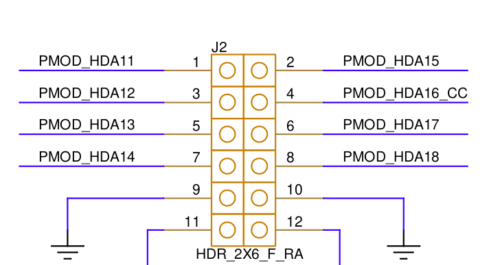
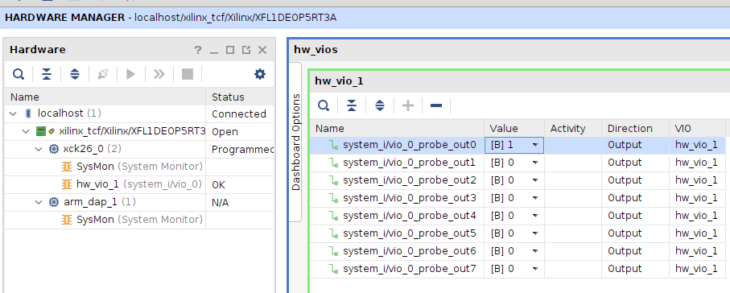
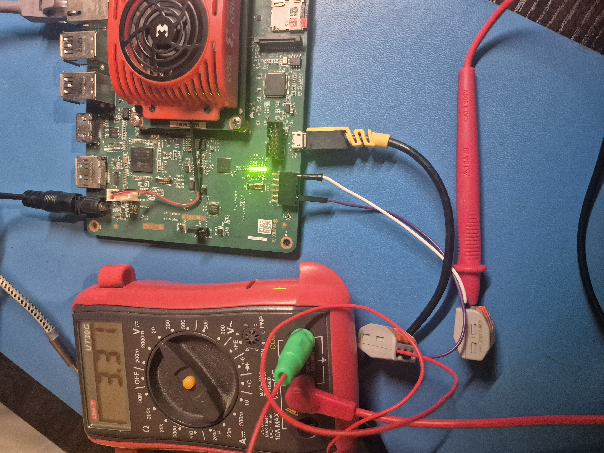

# PMOD

PMOD mapping/constraints check.
Just confirm the mapping from SOM to connector actually works.

## Result

numbering was a bit unexpected, where it doesn't go row  first, but rather column first according to the real connector numbering. Not an issue, but be pedantic...







## Configuration Management

once stream is loaded, running these commands in JTAG confirms they were set and retrievable.

// timestamp and fixed 32bit number
get_property REGISTER.USR_ACCESS [lindex [get_hw_devices] 0]
3db4ebd3
get_property REGISTER.USERCODE [lindex [get_hw_devices] 0]
deadbeef


Small script to interpret timestamp
```
python components/utils/stamp_to_date.py 0x3db4ebd3
7 11 2026 14 47 19
```

## References
[digilent reference](https://digilent.com/reference/pmod/specification?srsltid=AYCX9vKkCkpfS9XN3IBZxKBRU3JLhrILRnryPPfTpS-RTYwjvl5euzq9)

https://www.hackster.io/whitney-knitter/pmod-ip-development-for-kria-kv260-using-vitis-hls-069968


